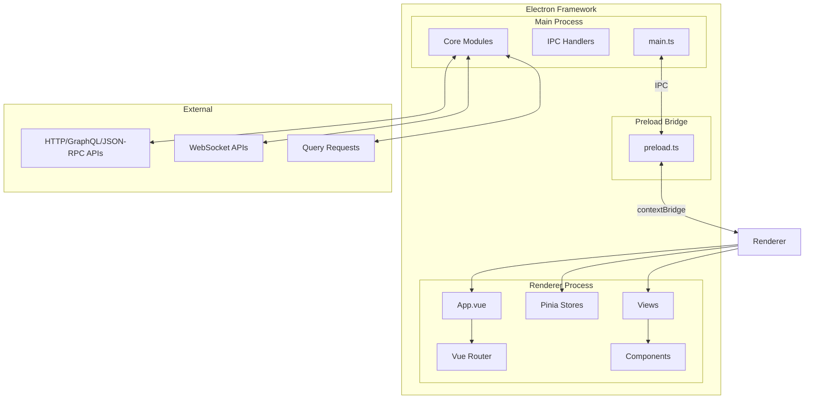
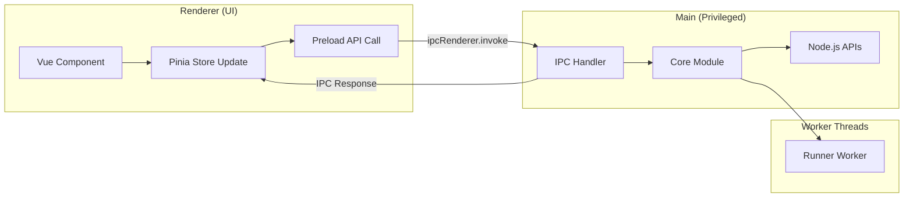
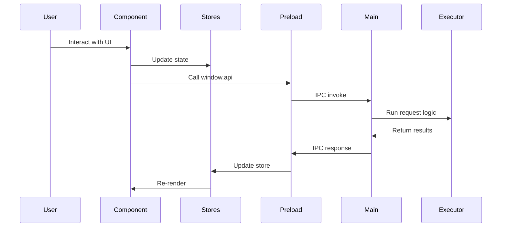
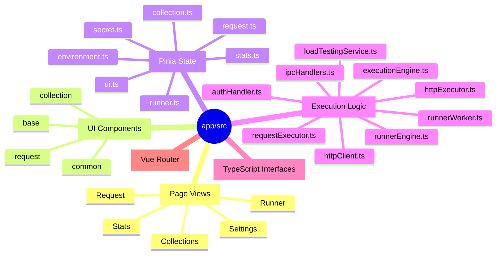
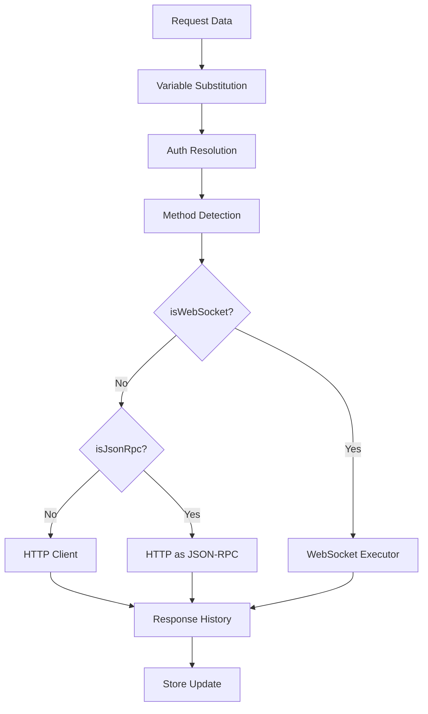
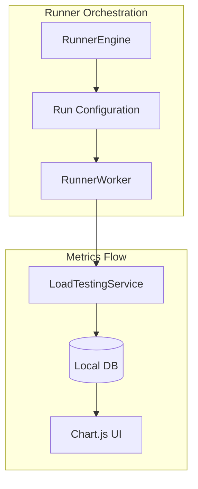
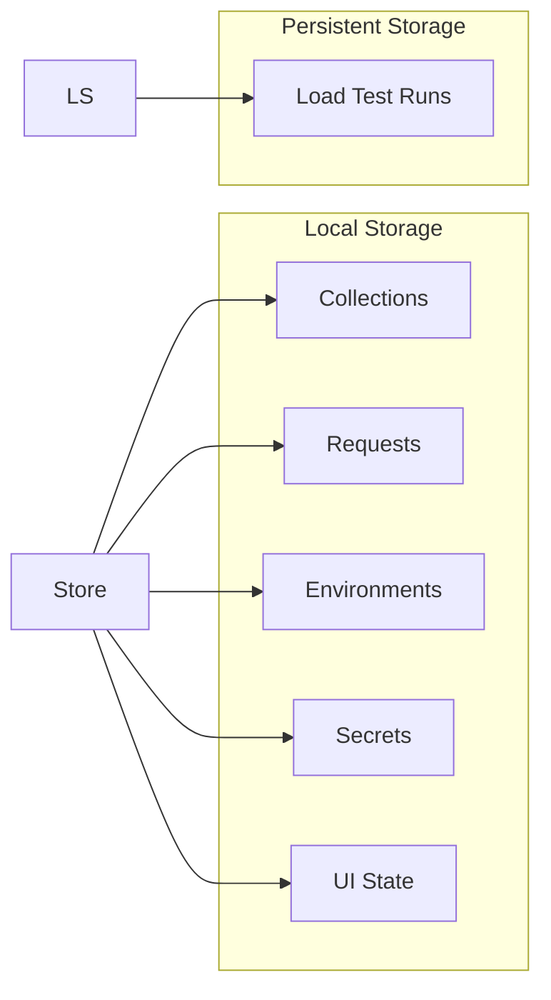
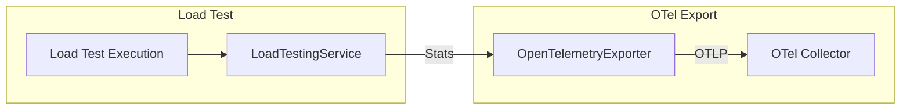

# Hailstorm: API Development Desktop App

A local-first Electron application for API development, testing, automation, and load testing. Built with Vue 3, Pinia, and Tailwind CSS.

## System Architecture

## Process Model

## Core Execution Flow

## Project Structure

## Request Execution Pipeline

## Runner Architecture

## Data Flow

## Security Model

- **Main Process**: Owns all privileged APIs (filesystem, child processes, network)
- **Preload Bridge**: Typed, minimal `contextBridge` exposing only necessary methods
- **Renderer**: Sandboxed, communicates via IPC only
- **Secrets**: Encrypted at rest, decrypted only when vault is unlocked

## Development Commands

From project root:

| Command | Purpose |
|---------|---------|
| `npm run dev` | Vite dev server |
| `npm run mock-server` | Test server on `127.0.0.1:4010` |
| `npx vite build` | Validate renderer/main/preload build |
| `npm run make` | Electron Forge packaging |

## Key Concepts

- **Collections**: Organize requests in folders
- **Environments**: Variable substitution for requests
- **Secrets**: Encrypted storage for sensitive values
- **Runner**: Execute single or multiple requests
- **Load Testing**: Concurrent request execution with metrics

## OpenTelemetry Integration

The Scenario Runner can export load test metrics to an OpenTelemetry collector:

### Configuration

Settings → Advanced → OpenTelemetry:
- **Endpoint**: OTLP HTTP endpoint (e.g., `http://localhost:4318/v1/traces`)
- **User ID**: Identifier for the runner (supports `{{secret.name}}` variable substitution)

### Mock Server OTel Endpoint

`POST http://127.0.0.1:4010/otel/v1/traces`

## Mock Server Endpoints

| Category | Endpoint | Description |
|----------|----------|-------------|
| HTTP | `/http/*` | Generic HTTP echo |
| Auth | `/http/auth/basic` | Basic auth required |
| Auth | `/http/auth/bearer` | Bearer token required |
| Auth | `/http/auth/apikey` | API key required |
| GraphQL | `/graphql` | GraphQL endpoint |
| JSON-RPC | `/json-rpc` | JSON-RPC 2.0 |
| OTel | `/otel/v1/traces` | OpenTelemetry collector mock |